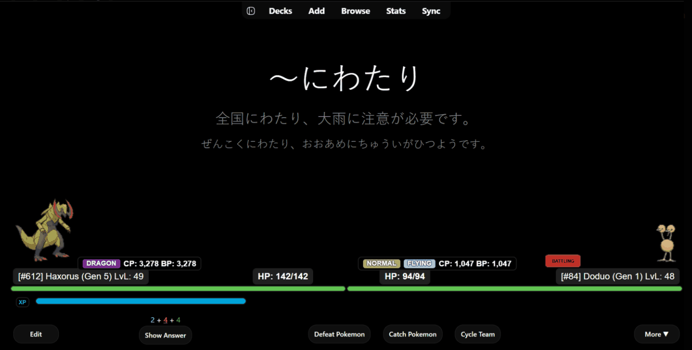
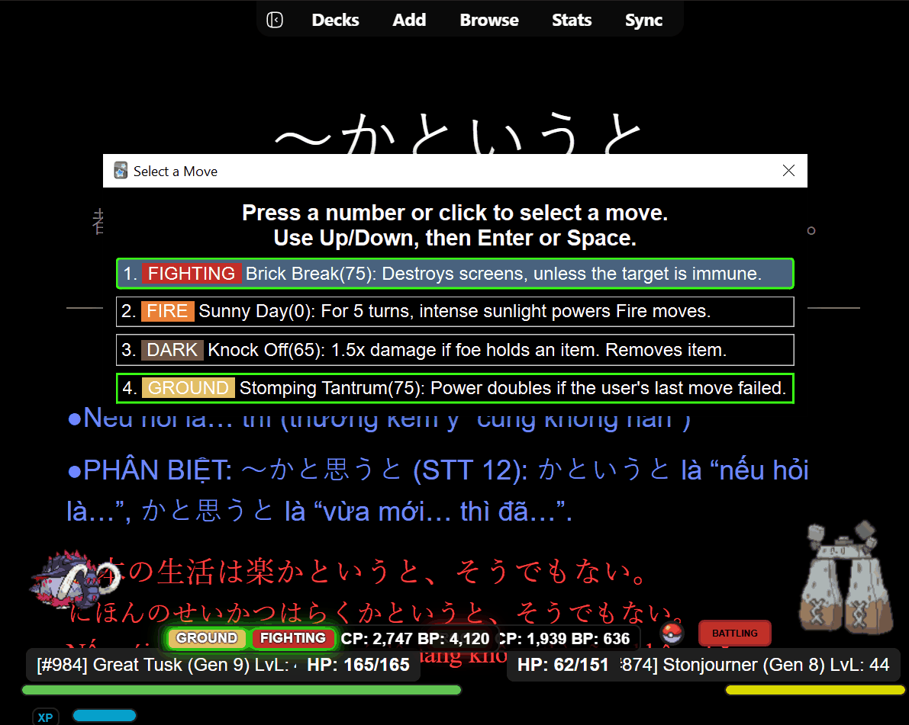

# Ankimon HUD Extras

A small companion add-on for [Ankimon](https://github.com/Unlucky-Life/ankimon) that adds **type badges, CP/BP stats and type-matchup hints** to the battle HUD and the move picker, without touching a single Ankimon file.

## Features

### Battle info pills on the reviewer HUD
- Shows a small info pill above each Pokémon's name bar during reviews, for both the wild/enemy Pokémon and your own.
- **Type badges**: each type is displayed as a colour-coded tag using the official Pokémon type colours.
- **CP and BP**: shows the Pokémon's Combat Power and current Battle Power (factoring in HP, type matchup and Atk/SpA stat stages), using Ankimon's own formulas and compact number formatting.
- Follows Ankimon's HUD layout setting: shows only the enemy's pill, both pills, or nothing, depending on how you display your main Pokémon in the reviewer.
- Positions adjust automatically to your HP bar thickness and XP bar spacing, and stay clear of the "BATTLING" badge.

### Type matchup glow
- Every type badge glows to show matchups at a glance (Gen 6+ type chart):
  - **Green**: this type is super effective against one of the opponent's types.
  - **Red**: one of the opponent's types is super effective against this type.
  - **Green + red split**: both at once.
- The same rule applies to both sides, so you can read your advantage and your weakness instantly.

### Enhanced "Select a Move" dialog

- Each move shows its type as a coloured tag, alongside its name, base power and short description.
- Attacking moves get a coloured border based on effectiveness against the current enemy:
  - **Green border**: super effective (×2 or more).
  - **Red border**: not very effective or no effect.
  - No border: neutral (×1). Status moves are left unmarked.

### HP fix when switching team Pokémon
- Fixes an Ankimon bug: when you cycle your team with the hotkey, the outgoing Pokémon's current HP is saved first, so switching back no longer restores stale HP from the database.

### Safe, non-invasive design
- **Does not modify any Ankimon files.** Everything is applied at runtime by wrapping Ankimon's functions.
- Works whatever Ankimon's add-on folder is named (AnkiWeb ID or GitHub install).
- Re-applies itself automatically every few seconds if Ankimon reloads its modules.
- Every hook is wrapped in error handling, so if something fails, Ankimon's own HUD and move picker keep working normally.

## Installation

1. Make sure **Ankimon** is already installed in Anki.
2. Download [`ankimon_extension.ankiaddon`](ankimon_extension.ankiaddon) (open the file, then click the **Download raw file** button).
3. Double-click the downloaded file, or in Anki go to **Tools → Add-ons → Install from file…** and select it.
4. Restart Anki.

## Compatibility
- Requires **Ankimon** to be installed.
- Relies on Ankimon's internal names (`Reviewer_Manager.update_life_bar`, `MoveSelectionDialog`, `cycle_team_pokemon`). If a future Ankimon update renames these, the affected feature will silently stop working until this add-on is updated.

## Support

If this add-on makes your reviews a bit more fun, starring ⭐ the repo, reporting bugs or suggesting features in [Issues](../../issues) is the best way to support it!

## Credits
- Built on top of [Ankimon](https://github.com/Unlucky-Life/ankimon) by Unlucky-Life and contributors.
- Pokémon and all related names are trademarks of Nintendo, Game Freak and The Pokémon Company. This is an unofficial fan project.
